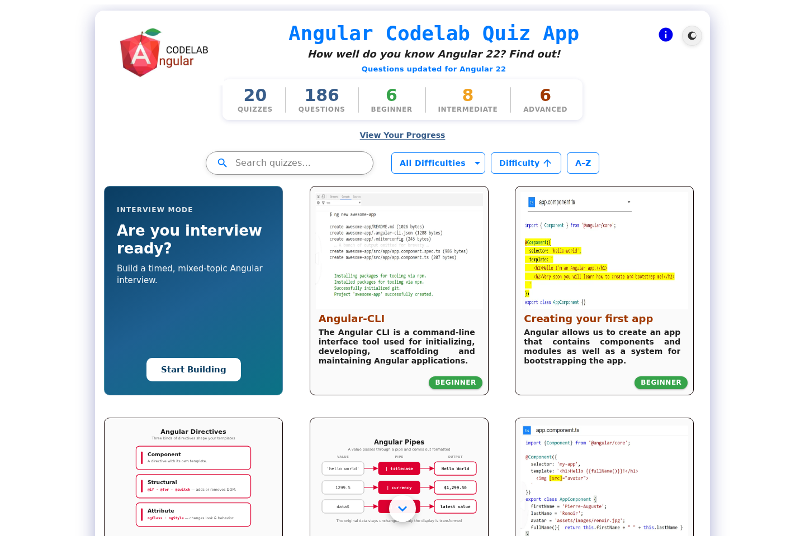
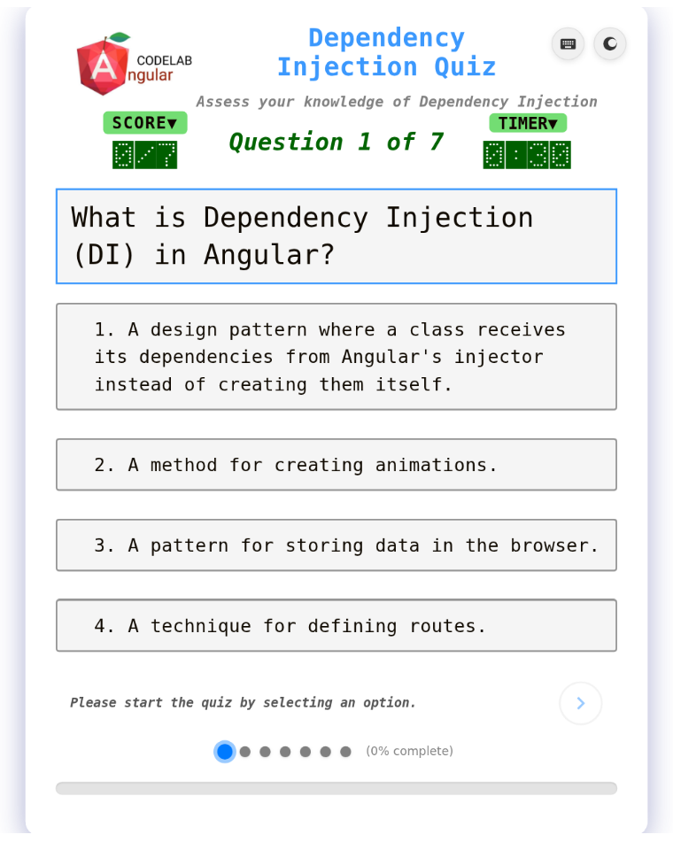
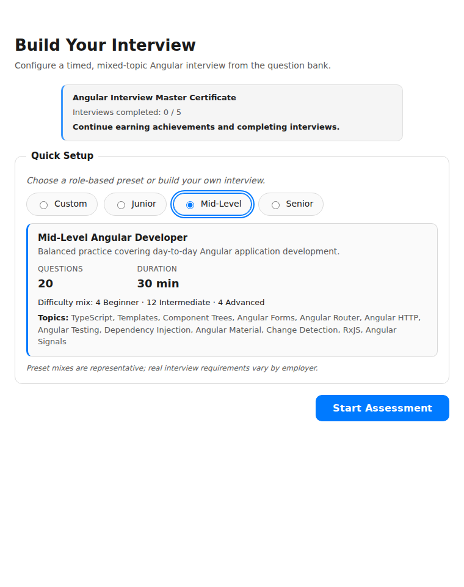
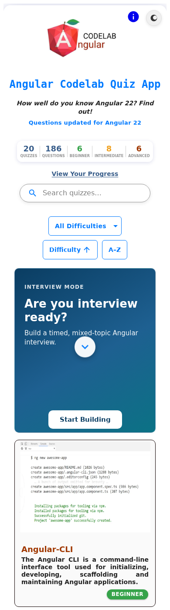

<h1 align="center">🚀 Angular Quiz & Interview Platform</h1>

  A full-stack Angular learning and interview-preparation platform featuring topic-based quizzes, timed assessments, performance analytics, targeted practice, and backend-authoritative scoring.

  Built with Angular 22, TypeScript, Signals, RxJS, and Angular Material, integrating Node.js/Express and Spring Boot REST APIs with PostgreSQL for secure quiz data management and backend-driven interview sessions.

  
  
  
  
  

  <a href="https://marvinrusinek.github.io/angular-22-quiz-app/">▶ <strong>Live Demo</strong></a>
  ·
  <a href="#-screenshots">📸 Screenshots</a>
  ·
  <a href="#-core-features">✨ Features</a>
  ·
  <a href="#-architecture-overview">🧭 Architecture</a>
  ·
  <a href="#getting-started">⚙️ Getting Started</a>

<h2>📸 Screenshots</h2>

  

<table>
  <tr>
    <td align="center">
       
      <strong>Topic Quiz</strong>
    </td>
    <td align="center">
       
      <strong>Interview Builder</strong>
    </td>
  </tr>
</table>

   
  <strong>Mobile Quiz Selection</strong>

<h2>🎯 Goal / Purpose</h2>

This project provides an interactive environment for learning, practicing, and assessing modern Angular knowledge through guided Topic Quizzes, timed interview-style assessments, and performance-based practice.

It also serves as a production-oriented full-stack engineering project for applying modern Angular patterns, designing secure frontend/backend boundaries, building reliable assessment workflows, and improving architecture, testing, accessibility, and performance.

<h2>✨ Core Features</h2>

<ul>
  <li><strong>Topic Quizzes:</strong> Single- and multiple-answer questions, code snippets, per-question timers, option shuffling, immediate feedback, explanations, and detailed result review.</li>
  <li><strong>Interview Mode:</strong> Configurable mixed-topic assessments with difficulty-based presets, timed sessions, deferred feedback, session recovery, server-side scoring, and protected result retrieval.</li>
  <li><strong>Performance Insights:</strong> Interview history, performance trends, topic-level analysis, progress tracking, and achievements that help users understand their results over time.</li>
  <li><strong>Weak Areas Practice:</strong> Uses previous performance data to identify weaker topics and generate targeted practice opportunities without affecting Interview Mode history.</li>
  <li><strong>Modern Angular Architecture:</strong> Standalone components, Signals, RxJS, Signal Forms, zoneless change detection, modular application domains, and focused service layers.</li>
  <li><strong>Secure Full-Stack Design:</strong> Node/Express powers Topic Quizzes, Spring Boot powers Interview Mode, and PostgreSQL serves as the authoritative data store. Correctness-sensitive data and scoring remain on the backend.</li>
  <li><strong>Testing and Reliability:</strong> Automated coverage across Angular, Node/Express, Spring Boot, database integration, API contract parity, and end-to-end workflows using Jest, Playwright, JUnit 5, MockMvc, and Testcontainers. A GitHub Actions workflow (<a href="./.github/workflows/frontend-ci.yml">frontend-ci.yml</a>) runs on every pull request and push to <code>main</code> that touches frontend code: TypeScript checks, the full Jest suite, a production build, and the quiz-bank artifact scanner. It verifies only — it never deploys.</li>
  <li><strong>Accessible, Responsive Experience:</strong> Angular Material, keyboard navigation, screen reader support tested with Windows Narrator in Chrome, mobile-responsive layouts, dark and light themes, and Progressive Web App support.</li>
  <li><strong>Interview Certificate Claims (Production Rollout Pending):</strong> Implemented email-verified certificate claiming, recovery, and owner notifications using the Node/Express backend and PostgreSQL. Validated through automated browser tests and controlled email-delivery testing. Production enablement remains pending. See the certificate claims runbook for implementation details.</li>
</ul>

<h2>🧭 Architecture Overview</h2>

The application follows a modular frontend/backend architecture. Angular container components orchestrate application flow, focused services encapsulate business logic, and Signals and RxJS keep the UI synchronized with user interactions. Topic Quizzes, quiz metadata, and certificate claims are served through a Node/Express REST API, while Interview Mode session workflows are served through a Spring Boot REST API. Both backends connect to a shared PostgreSQL database, hosted on Neon in production, which serves as the authoritative store for quiz content, assessment sessions, submitted answers, server-side results, and issued certificates.

The frontend combines <strong>Angular Signals</strong> for fine-grained reactive UI state with <strong>RxJS</strong> for asynchronous data flows, event coordination, and cross-component communication. Correctness-sensitive operations remain backend-authoritative so answer-bearing quiz data is not shipped with the Angular application. 

<h3>High-Level Flow</h3>

<pre><code>
                    Angular 22 Frontend
                           │
               ┌───────────┴───────────┐
               │                       │
         Topic Quizzes            Interview Mode
               │                       │
        Node / Express             Spring Boot
               │                  Spring JDBC
               │                 Spring Data JPA*
               │                       │
               └───────────┬───────────┘
                           │
                    PostgreSQL / Neon

* Spring Data JPA is used for quiz metadata;
  Interview persistence primarily uses Spring JDBC.
</code></pre>

<h2>🛠️ Technology Stack</h2>

<ul>
  <li><strong>Frontend:</strong> Angular 22, TypeScript</li>
  <li><strong>Reactive State:</strong> Angular Signals, RxJS</li>
  <li><strong>UI:</strong> Angular Material, SCSS</li>
  <li><strong>Forms:</strong> Reactive Forms, Signal Forms</li>
  <li><strong>HTTP Integration:</strong> Angular HttpClient, Fetch API, HTTP Interceptors</li>
  <li><strong>Topic Quiz REST API:</strong> Node.js 22, Express, TypeScript</li>
  <li><strong>Interview REST API:</strong> Java 21, Spring Boot, Spring JDBC, Spring Data JPA</li>
  <li><strong>Database:</strong> PostgreSQL — Neon-hosted in production</li>
  <li><strong>Security:</strong> Backend-authoritative correctness, strict CSP, CORS allow-list, rate limiting, HMAC-signed attempt receipts</li>
  <li><strong>Testing:</strong> Jest, Playwright, JUnit 5, MockMvc, Testcontainers, API contract-parity testing</li>
  <li><strong>Platform:</strong> Progressive Web App (PWA)</li>
  <li><strong>Hosting:</strong> GitHub Pages, Render, Oracle Cloud Infrastructure, Neon</li>
  <li><strong>Transactional Email:</strong> Postmark HTTPS API for certificate verification, recovery, and owner notifications; optional SMTP support.</li>
</ul>

<h2>📁 Project Structure</h2>

The project is organized into an Angular frontend, dedicated Node/Express and Spring Boot APIs, automated end-to-end testing, and deployment infrastructure, with focused service layers and clear separation between application domains.

<pre><code>
angular-22-quiz-app/
├── src/
│   └── app/
│       ├── components/
│       ├── containers/
│       └── shared/
│           ├── services/
│           ├── models/
│           └── utils/
│
├── backend/                         # Node/Express API
│   └── src/
│       ├── routes/
│       ├── quiz/
│       ├── interview/
|       ├── certificate/
│       └── db/
│
├── backend-spring/                  # Spring Boot API
│   └── src/
│       ├── main/
│       │   └── java/
│       └── test/
│
├── e2e/                             # Playwright end-to-end tests
│
├── deploy/
│   └── oracle/                      # Oracle Cloud deployment
│
├── docs/
├── scripts/
└── ...
</code></pre>

<h2>⚙️ Getting Started</h2>

<h3>Prerequisites</h3>

<ul>
  <li>Node.js 22 or later</li>
  <li>Angular CLI 22</li>
  <li>Java 21</li>
  <li>PostgreSQL-compatible database access (Neon is used in production)</li>
</ul>

The project uses two backend services: a Node/Express API for Topic Quizzes and a Spring Boot API for Interview Mode. Both services connect to PostgreSQL.

<h3>Installation</h3>

<pre><code>git clone https://github.com/marvinrusinek/angular-22-quiz-app.git
cd angular-22-quiz-app
npm install</code></pre>

<h3>Database Configuration</h3>

PostgreSQL serves as the authoritative data store for quiz content, interview sessions, submitted answers, and assessment results. Production uses Neon-hosted PostgreSQL.

Before starting the backend services, configure the required database connections and environment variables. Refer to the Node/Express environment configuration for available settings.

Both backend services require access to PostgreSQL. Keep database credentials, API keys, and application secrets in local environment configuration and never commit sensitive information to source control.

<h3>Run the Topic Quiz API and Angular Frontend</h3>

The Node/Express backend serves Topic Quizzes, quiz metadata, and certificate claim endpoints.

Start the Node/Express API and Angular development server together:

<pre><code>npm run dev</code></pre>

This command starts both development services. The Angular application is available at http://localhost:4200, while the Node/Express API runs on port 3000 by default.

Certificate claim functionality requires additional configuration and is disabled by default.

<h3>Run the Interview API</h3>

Interview Mode is served by the Spring Boot backend. The project includes the Maven Wrapper, so a separate global Maven installation is not required.

<pre><code>cd backend-spring
./mvnw spring-boot:run</code></pre>

On Windows PowerShell:

<pre><code>cd backend-spring
.\mvnw.cmd spring-boot:run</code></pre>

The Spring Boot API runs locally on port <code>8080</code> when using the default development configuration.

<h3>Run the Angular Frontend separately</h3>

If the frontend is not already running through the development command, start it separately with:

<pre><code>ng serve</code></pre>

Open your browser and navigate to:

<pre><code>http://localhost:4200</code></pre>

For full local functionality, ensure the Angular frontend, Node/Express Topic Quiz API, Spring Boot Interview API, and PostgreSQL database are running and correctly configured.

Topic Quizzes require the Node/Express API, while Interview Mode requires the Spring Boot API. Features that depend on unavailable backend services or missing configuration may not function as expected.

<h2>🗺️ Roadmap</h2>

<ul>
  <li>Expand the quiz bank with additional scenario-based, code-focused, and advanced Angular questions</li>
  <li>Continue improving accessibility, screen reader compatibility, keyboard navigation, and mobile responsiveness</li>
  <li>Enhance Interview Mode with deeper performance analytics, topic trends, and personalized practice recommendations</li>
  <li>Evaluate Angular Resource API (resource(), rxResource(), httpResource()) for appropriate REST API integrations</li>
  <li>Explore Angular @defer for lazy loading non-critical components and improving rendering performance</li>
  <li>Review API Model-Adapter patterns to strengthen frontend/backend separation and maintainability</li>
  <li>Expand automated security, performance, accessibility, and cross-platform regression coverage</li>
  <li>Adopt new Angular APIs, Signals, and reactive patterns where they provide measurable architectural or user-experience improvements</li>
</ul>

## ⭐ Support

If you find this project useful for learning Angular, practicing your skills, or preparing for technical interviews, please consider giving it a ⭐ on GitHub.

Your support helps increase the project's visibility and encourages continued development, new features, and ongoing improvements.

This project continues to evolve, with a focus on modern Angular development, accessibility, interactive assessments, and a better learning experience for the Angular community.

<h2>📄 License</h2>

Copyright © 2026. All rights reserved.

This project is publicly available for educational viewing and portfolio demonstration purposes.

No permission is granted to copy, modify, redistribute, or commercially use the source code without prior written authorization from the copyright holder.

